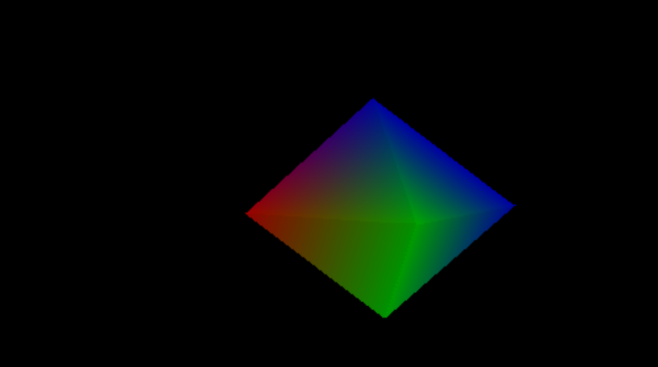
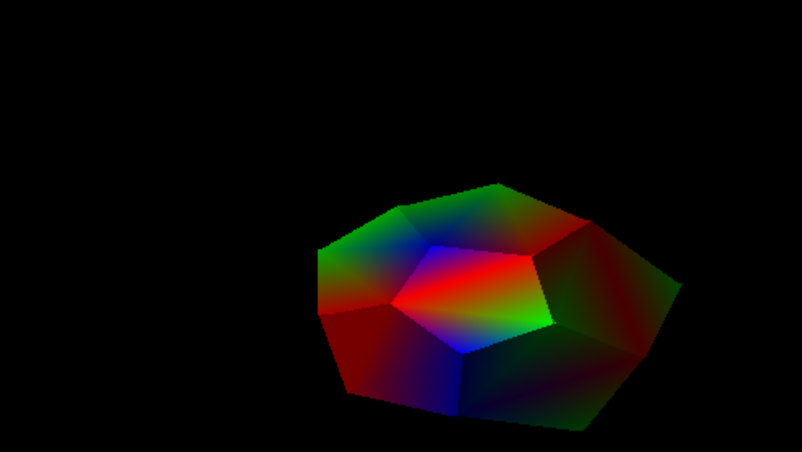
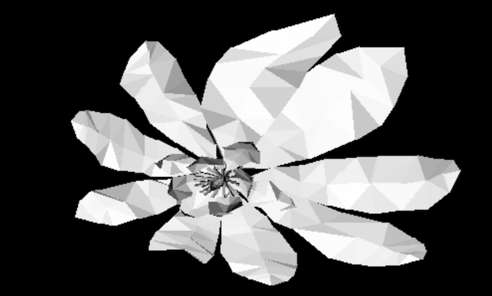
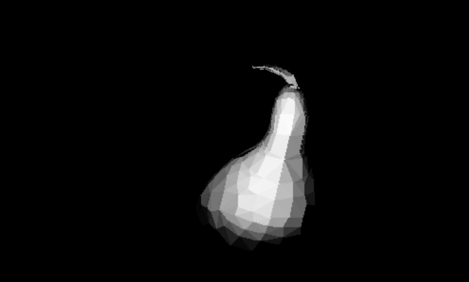

# 3DRenderer

## Setup

1. `git clone --recurse-submodules -b project https://github.com/TrueAstralpirate/3DRenderer.git`
2. `apt-get install libsdl2-dev` or `yum install SDL2-devel`
3. `cd 3DRenderer`
4. `cd build`
5. `cmake ..`
6. `make`

## Usage example

1. `./run 0 0 140 0 0 0 600 400`
2. Press Space
3. Enter `diamond.obj 0 0 0` in the console

Controls: arrow keys to move, mouse/trackpad to rotate the camera.

**Note:** On Linux, camera rotation may not work correctly due to a bug in SDL2 that incorrectly reads cursor changes.

## Screenshots

